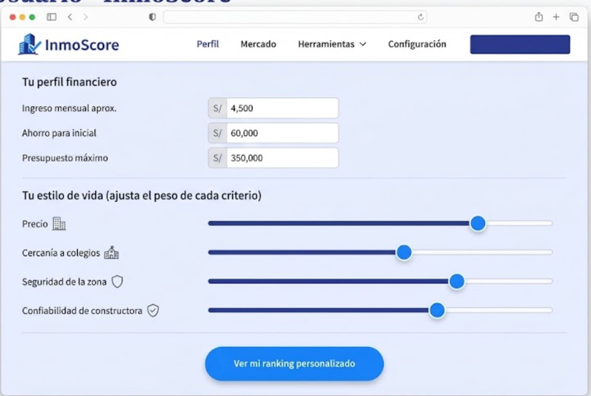
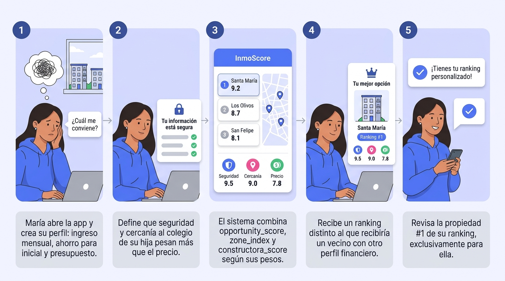

# Requirements Artifacts — InmoScore

Artefactos de elicitación de requerimientos de Week 5. Cada uno está trazado a uno de los dos requerimientos documentados en [`Requirements.md`](Requirements.md) §0.

| Artefacto | Cubre | Diapositivas |
|---|---|---|
| User stories US-01 y US-02 | REQ-01, REQ-02 | 11–12 |
| Wireframes | REQ-01, REQ-02 | 13–14 |
| Storyboards | REQ-01, REQ-02 | 15–16 |
| Casos de uso UC-01 y UC-02 | REQ-01, REQ-02 | 17–18 |
| Tareas analíticas | RF-01 a RF-11 | 19 |

- **REQ-01** — Motor de recomendación personalizado: generar un ranking de propiedades único por usuario.
- **REQ-02** — Explicabilidad: ninguna recomendación se muestra sin su explicación en lenguaje natural.

---

## 1. User Stories

### US-01 · Ranking personalizado — cubre REQ-01

> **Como** comprador de vivienda propia,
> **quiero** recibir un ranking personalizado de propiedades según mis prioridades financieras y de estilo de vida,
> **para** poder identificar rápidamente las mejores opciones sin revisar manualmente cada portal.

**Criterios de aceptación**

| # | Given | When | Then |
|---|---|---|---|
| 1 | El usuario definió sus pesos de preferencia | Solicita recomendaciones | El sistema devuelve un ranking ordenado por score compuesto |
| 2 | Existe un cambio en las preferencias | El usuario las actualiza | El ranking se recalcula |

**Flujo de datos**

```
Perfil del usuario ─┐
                    ├─→ Motor de recomendación ─→ Ranking explicado
opportunity_score  ─┤
zone_composite_index┤
constructora_score ─┘
```

Los tres scores individuales, ponderados por el perfil del usuario, convergen en un ranking único y explicado por persona.

### US-02 · Explicabilidad de la recomendación — cubre REQ-02

> **Como** comprador de vivienda propia,
> **quiero** ver una explicación en lenguaje natural junto a cada propiedad recomendada, incluso cuando falte algún dato,
> **para** poder confiar en el ranking sin sentir que es una caja negra.

**Criterios de aceptación**

| # | Given | When | Then |
|---|---|---|---|
| 1 | Existe un ranking generado | Se muestra cada propiedad | Debe incluir una explicación textual asociada |
| 2 | Falta un componente del score | Se genera la explicación | El sistema indica "dato parcial" en vez de omitirlo |

**Flujo de datos**

```
Scores + variables ─→ Generador de       ─→ Texto explicativo ─→ Mostrado junto
que más pesaron      explicación (NL)       por propiedad        al ranking
```

---

## 2. Wireframes

### WF-01 · Pantalla de perfil y preferencias — cubre REQ-01



Captura las dos entradas que exige REQ-01:

- **Perfil financiero:** ingreso mensual aproximado, ahorro para la inicial y presupuesto máximo.
- **Estilo de vida:** sliders de peso para precio, cercanía a colegios, seguridad de la zona y confiabilidad de la constructora.

Un único botón de acción (*Ver mi ranking personalizado*) cumple RNF-04: obtener resultado en menos de tres pasos.

### WF-02 · Tarjeta de propiedad con explicación — cubre REQ-02


Cada propiedad del ranking muestra sus tres scores (`opportunity_score`, `zone_composite_index`, `constructora_score`) y, debajo, el bloque **"Por qué te lo recomendamos"** con la explicación en lenguaje natural.

Incluye el caso límite que exige REQ-02: cuando falta un componente, el score se marca como **parcial** y la explicación lo declara ("sin información de calidad visual del entorno para esta propiedad") en vez de omitir la propiedad o inventar el valor.

---

## 3. Storyboards

### SB-01 · María recibe un ranking hecho a su medida — cubre REQ-01



| # | Momento |
|---|---|
| 1 | María abre la app y crea su perfil: ingreso mensual, ahorro para inicial y presupuesto. |
| 2 | Define que seguridad y cercanía al colegio de su hija pesan más que el precio. |
| 3 | El sistema combina `opportunity_score`, `zone_composite_index` y `constructora_score` según sus pesos. |
| 4 | Recibe un ranking distinto al que recibiría un vecino con otro perfil financiero. |
| 5 | Revisa la propiedad #1 de su ranking, hecho exclusivamente para ella. |

### SB-02 · Carlos entiende el porqué de cada recomendación — cubre REQ-02


| # | Momento |
|---|---|
| 1 | Carlos ve una propiedad con score alto en su ranking, pero no sabe por qué. |
| 2 | Abre la tarjeta y lee: "12% bajo el precio esperado, a 8 min de un colegio afín". |
| 3 | Nota el aviso "dato parcial" en el `zone_composite_index` de esa propiedad. |
| 4 | Compara la explicación de dos propiedades distintas de su ranking. |
| 5 | Confía en la recomendación porque entiende exactamente su origen. |

---

## 4. Casos de uso

### UC-01 · Generar ranking personalizado de propiedades — cubre REQ-01

| Campo | Detalle |
|---|---|
| **Actor** | Comprador de vivienda propia |
| **Precondición** | El usuario configuró su perfil financiero y de estilo de vida; existen propiedades con `opportunity_score`, `zone_composite_index` y `constructora_reliability_score` calculados |
| **Postcondición** | El usuario obtiene un ranking ordenado y personalizado, distinto al de cualquier otro perfil |

**Flujo principal**

1. El usuario ingresa a la plataforma y accede al formulario de preferencias.
2. Define pesos para precio, ubicación, seguridad, colegios y confiabilidad de constructora.
3. El sistema recupera `opportunity_score`, `zone_composite_index` y `constructora_reliability_score` de cada inmueble activo.
4. El sistema combina los tres scores, ponderados según los pesos declarados.
5. El sistema genera un ranking ordenado por el score compuesto resultante.
6. El sistema despliega el ranking personalizado al usuario.

**Flujos alternativos**

- **3a.** Si falta un componente del score (por ejemplo, sin `visual_quality_score`), el sistema marca la propiedad como *dato parcial* en vez de omitirla o inventar el valor.
- **4a.** Dos usuarios con perfiles distintos que consultan el mismo inventario reciben rankings diferentes.

### UC-02 · Consultar la explicación de una recomendación — cubre REQ-02

| Campo | Detalle |
|---|---|
| **Actor** | Comprador de vivienda propia |
| **Precondición** | Existe un ranking generado (resultado de UC-01) con al menos una propiedad recomendada |
| **Postcondición** | Ninguna propiedad del ranking se muestra sin su explicación asociada |

**Flujo principal**

1. El usuario visualiza el ranking de propiedades recomendadas.
2. Por cada propiedad, el sistema genera automáticamente una explicación en lenguaje natural a partir de las variables que más pesaron en el score (gap de precio, distancia a colegio, etc.).
3. El sistema muestra la explicación junto a cada propiedad, sin que el usuario deba solicitarla.
4. El usuario lee la explicación y decide si abrir el detalle de la propiedad.

**Flujo alternativo**

- **2a.** Si el sistema no puede generar una explicación completa por datos parciales, debe indicarlo explícitamente en el texto en vez de omitir la explicación.

---

## 5. Tareas analíticas

| # | Tarea | Responsable | Requerimiento | Justificación |
|---|---|---|---|---|
| 1 | EDA de listados inmobiliarios | Lisseth | RF-01, RF-03 | Detectar outliers y evaluar completitud antes de entrenar el motor de valoración. En Week 4 el filtro por rango intercuartílico ya descartó 91 de 3 987 avisos. |
| 2 | Geocodificación de direcciones | Denzel / Lisseth | RF-02 | Los listados no traen coordenadas. Sin geocodificar con Nominatim no se pueden calcular distancias a POIs, que es el enriquecimiento central del pipeline. |
| 3 | Feature engineering geoespacial | Lisseth / Jyns | RF-02, RF-06 | Calcular distancias Haversine a los 16 987 POIs habilita el índice de conveniencia urbana. |
| 4 | Construcción del ground truth de precios | Jyns | RF-03 | Consolidar las transacciones del Impuesto de Alcabala y definir el criterio de percentil por distrito, dado el sesgo de cocheras y depósitos. |
| 5 | Entrenamiento del motor de valoración | Jyns | RF-03, RF-04 | Modelo de regresión para `predicted_price_soles`, evaluado con MAE contra transacciones reales y comparado con el baseline de precio por m². |
| 6 | Entrenamiento del modelo de visión | Jyns | RF-05 | CNN por transfer learning sobre imágenes de zona para `visual_quality_score`. **Bloqueada:** sin dataset de imágenes, se debe conseguir la fuente o replantear el alcance. |
| 7 | Diseño del índice compuesto de zona | Jyns / Lisseth | RF-06 | Combina seguridad, conveniencia urbana y percepción visual en un solo score. Hoy operativo con 2 de sus 3 componentes en 47 distritos. |
| 8 | Diseño del score de confiabilidad | Lisseth | RF-07 | Agrega historial de proyectos y antigüedad por constructora, partiendo de los 460 promotores del Fondo MIVIVIENDA. |
| 9 | Motor de recomendación ponderado | Jyns | RF-08, RF-09, RF-10 | Combina todos los scores según el perfil declarado por el usuario para producir un ranking distinto por persona. |
| 10 | Generación de explicaciones en lenguaje natural | Jyns / Mafer | RF-11 | Traduce las variables que más pesaron en el score en una explicación legible, requisito de REQ-02. |

**Nota sobre el estado real.** Las tareas 2, 4 y 6 se agregaron o reformularon después de la adquisición de datos de Week 4: la geocodificación resultó ser el bloqueo principal del pipeline, el ground truth de precios pasó a existir gracias al Impuesto de Alcabala, y el modelo de visión quedó bloqueado por falta de fuente de imágenes. El detalle está en [`Requirements.md`](Requirements.md) §8 y §9.
