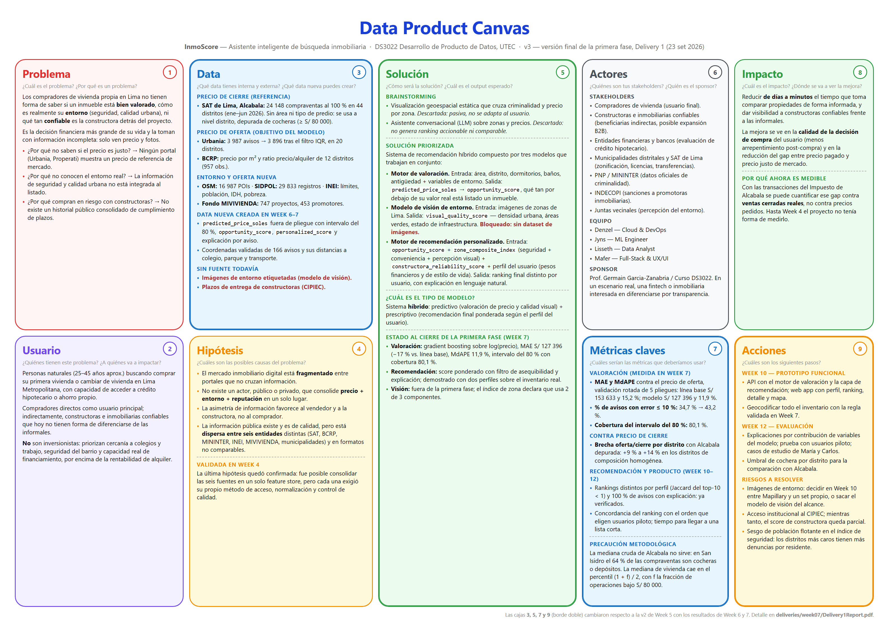
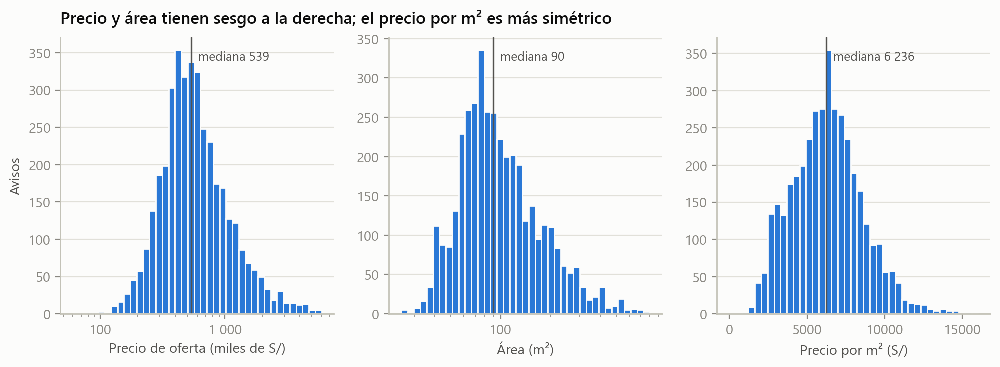
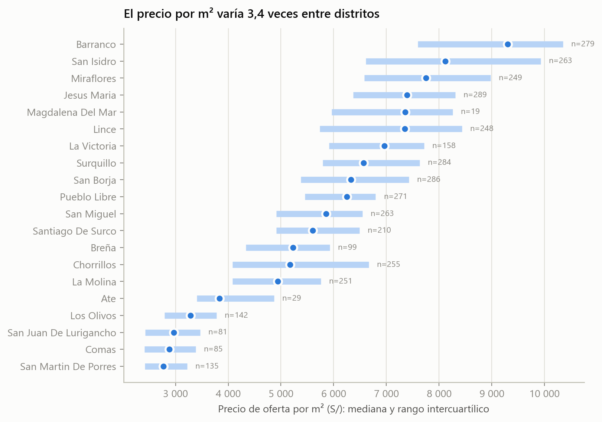
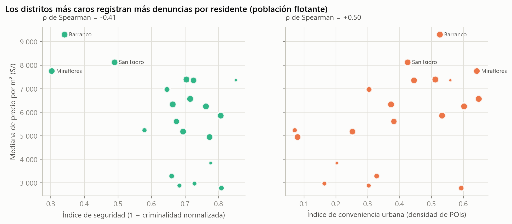
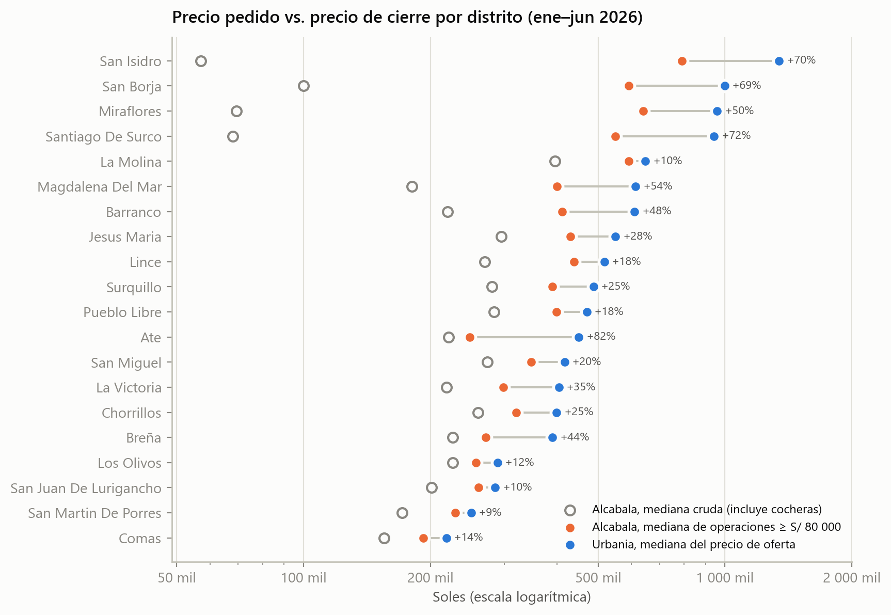
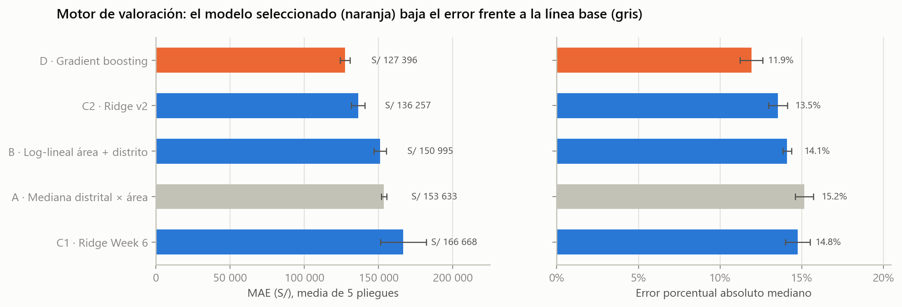
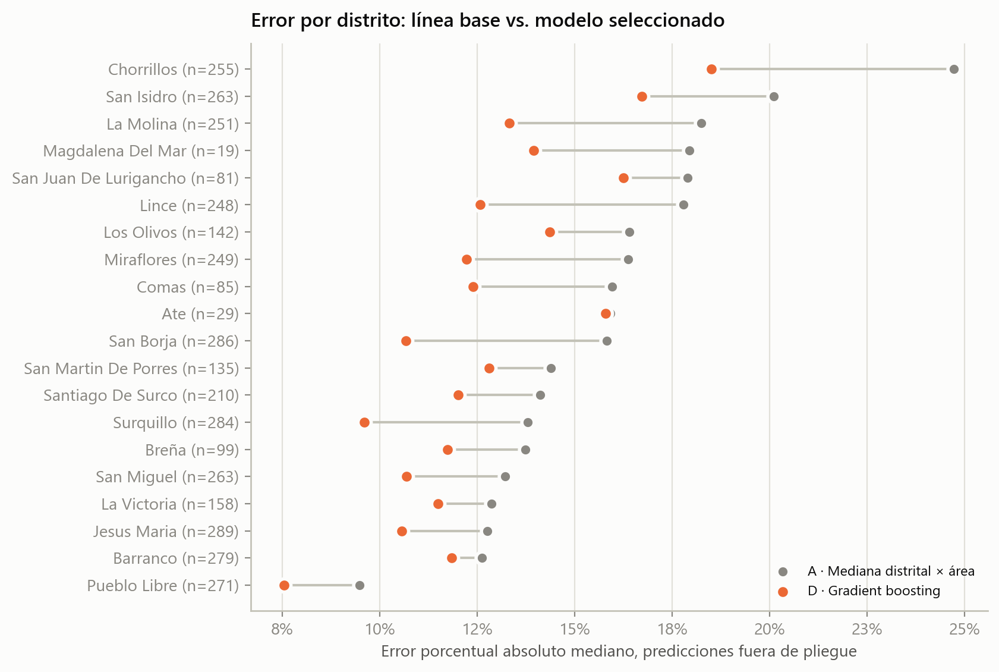
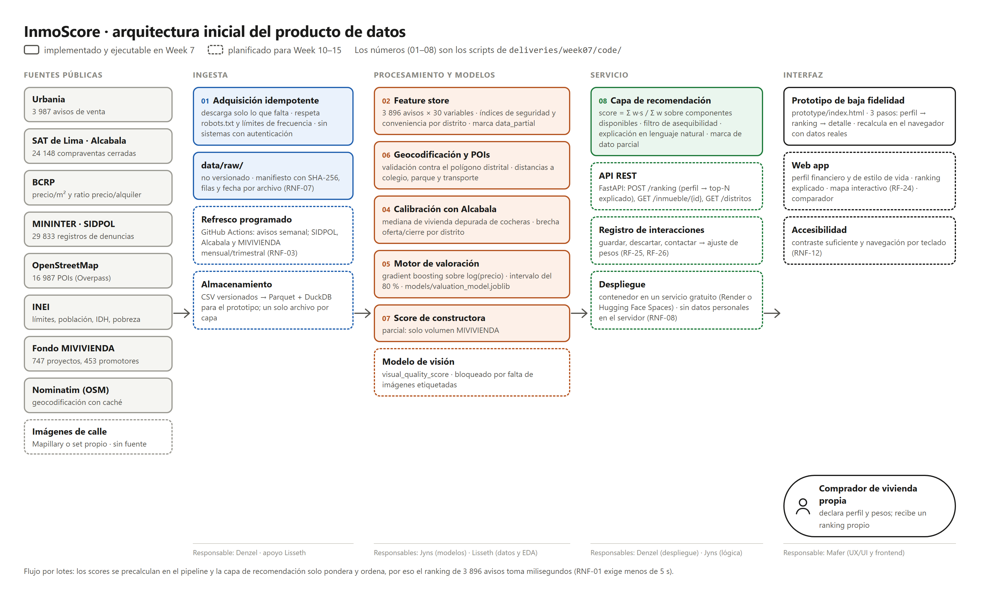
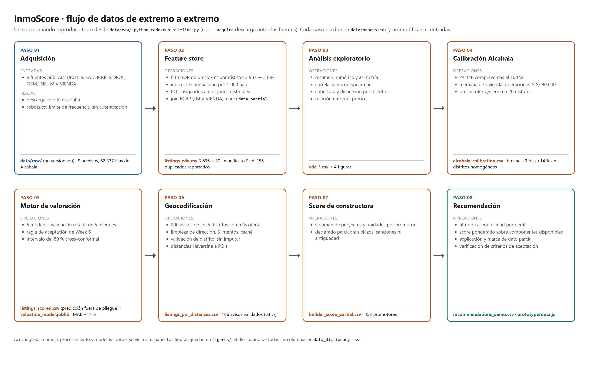
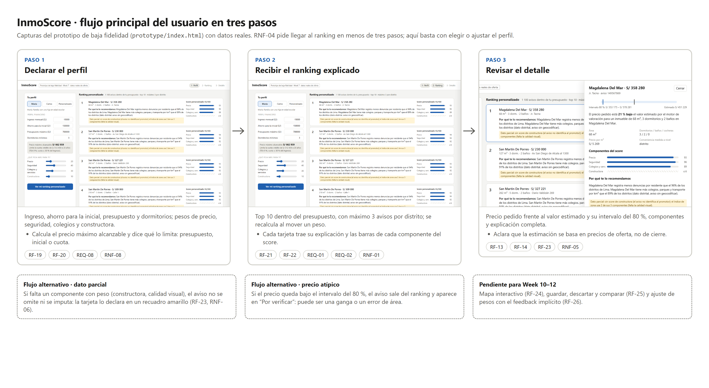

<div class="cover" markdown="1">

# InmoScore

## Delivery 1 · Definición integrada del producto de datos

**DS3022 Desarrollo de Producto de Datos** · Universidad de Ingeniería y Tecnología (UTEC)
Prof. Germain Garcia-Zanabria · Semestre 2026-2 · 23 de setiembre de 2026

**Equipo:** Denzel (Cloud & DevOps) · Jyns (Machine Learning) · Lisseth (Data Analyst) · Mafer (Full-Stack & UX/UI)

**Repositorio:** [github.com/Jyns123/DPD](https://github.com/Jyns123/DPD) · carpeta `deliveries/week07/`

</div>

## Resumen

InmoScore es un asistente de búsqueda de vivienda para compradores que buscan casa propia en Lima Metropolitana. Para cada aviso publicado estima un valor de referencia con su rango de incertidumbre y lo ordena según las prioridades que declara cada comprador: precio, seguridad, cercanía a colegios y servicios, y confiabilidad de la constructora. Cada recomendación viene con una explicación en lenguaje natural y declara qué datos le faltan.

Esta entrega cierra la primera fase del proyecto. Consolida el trabajo de Week 4 a Week 6 y agrega cuatro resultados nuevos:

1. **Motor de valoración evaluado con validación rotada.** Un gradient boosting sobre el logaritmo del precio baja el error absoluto medio de S/ 153 633 a S/ 127 396 (−17 %) frente a la línea base de mediana distrital, mejora el error en los 20 distritos y entrega un intervalo del 80 % con cobertura medida de 80,1 %. La partición de Week 6 se reproduce al céntimo.
2. **Transacciones reales incorporadas.** Las 24 148 compraventas del Impuesto de Alcabala entran al pipeline con un criterio formal para descartar cocheras y depósitos. En los distritos de composición homogénea, el precio pedido supera al de cierre entre 9 % y 14 %.
3. **Geocodificación escalada.** De 10 avisos de prueba en Week 6 a 200 en los cinco distritos con más oferta, con 83 % de coordenadas validadas contra el distrito declarado y distancias a colegios, parques y transporte.
4. **Capa de recomendación y prototipo de baja fidelidad.** Implementa el score personalizado, la explicación y la marca de dato parcial. Verifica sobre el inventario real los criterios de aceptación de REQ-01 y REQ-02 con dos perfiles contrastantes, y los expone en un prototipo navegable que reproduce exactamente el ranking del pipeline.

Todo se reproduce con `python code/run_pipeline.py` desde `deliveries/week07/`.

<div class="page-break"></div>

## 1. Problema, contexto y propuesta de valor

### 1.1 Problema

Comprar vivienda es, para la mayoría de familias, la decisión financiera más grande de su vida, y en Lima se toma con información incompleta. Los portales publican precio, área y fotos, pero no responden tres preguntas que el comprador necesita resolver antes de visitar un inmueble:

- **¿El precio pedido es razonable para lo que ofrece?** El precio por m² varía 3,4 veces entre distritos (de S/ 2 773 en San Martín de Porres a S/ 9 299 en Barranco), y dentro de un mismo distrito la mediana distrital se equivoca en 15 % o más en la mitad de los avisos. Además, el precio publicado no es el de cierre: en los distritos donde la comparación es limpia, la mediana de oferta supera a la de las compraventas registradas por el SAT entre 9 % y 14 %.
- **¿Cómo es el entorno?** La seguridad, los colegios y el transporte no aparecen en el aviso. El único indicador público de seguridad por distrito, las denuncias por residente, además penaliza a los distritos con mucha población flotante (§5.4).
- **¿Quién construye?** En proyectos en planos el comprador paga por adelantado sin referencia pública del historial del promotor.

**Enunciado revisado.** Los compradores de vivienda propia en Lima no tienen una forma accesible de saber si el precio de un aviso es razonable para sus características y su zona, ni de comparar avisos según sus propias prioridades de precio, entorno y riesgo, con información que puedan verificar.

### 1.2 Contexto

La información para responder esas preguntas existe, pero está dispersa entre siete entidades con formatos incompatibles: Urbania, el SAT de Lima, el BCRP, MININTER, el INEI, el Fondo MIVIVIENDA y OpenStreetMap. Consolidarla fue el trabajo de Week 4 a Week 6. Esta entrega demuestra que, una vez consolidada, alcanza para producir una valoración con error medido y un ranking personalizado y explicable.

### 1.3 Propuesta de valor

| Para quién | Qué recibe | Evidencia en esta entrega |
|---|---|---|
| Comprador de vivienda propia | Valor estimado de cada aviso con su intervalo del 80 % y la brecha frente al precio pedido | MdAPE de 11,9 %; cobertura del intervalo 80,1 % |
| El mismo comprador | Un ranking propio según su capacidad de pago y sus prioridades, con la razón de cada posición | Dos perfiles producen rankings distintos; 100 % de los avisos con explicación |
| El mismo comprador | Avisos "demasiado baratos" separados como *por verificar*, en vez de presentarlos como gangas | 388 avisos (10 %) quedan bajo el intervalo del 80 % |
| Mercado formal | Visibilidad del volumen de obra de 453 promotores del Fondo MIVIVIENDA | Score parcial, declarado como tal |

**Cambio de alcance respecto a Week 5.** El modelo de visión por computadora pasa de "componente del MVP" a "condicionado a conseguir datos": no existe todavía un conjunto de imágenes de calle etiquetado y legalmente utilizable. El índice de zona declara en cada aviso que usa 2 de sus 3 componentes. La decisión final se toma en Week 10 (§9).

## 2. Usuarios, stakeholders y necesidades

**Usuario principal.** Personas de 25 a 45 años que buscan su primera vivienda o cambiar de vivienda en Lima Metropolitana, con acceso a crédito hipotecario o ahorro propio. No son inversionistas: priorizan colegios, trabajo, seguridad y capacidad real de pago sobre la rentabilidad del alquiler.

Dos perfiles guían el diseño y la demostración. Son los mismos de los storyboards de Week 5, ahora con parámetros concretos:

| Perfil | Situación | Ingreso · ahorro · presupuesto | Pesos: precio · seguridad · colegios y servicios · constructora | Precio máximo alcanzable |
|---|---|---|---|---|
| **María** | Familia con una hija en edad escolar; al menos 3 dormitorios | S/ 15 000 · S/ 150 000 · S/ 700 000 | 20 · 40 · 30 · 10 | S/ 662 959, limitado por la cuota |
| **Carlos** | Primer comprador; al menos 2 dormitorios | S/ 9 000 · S/ 60 000 · S/ 400 000 | 60 · 15 · 20 · 5 | S/ 367 775, limitado por la cuota |

El precio máximo alcanzable es el menor entre el presupuesto declarado, el ahorro dividido entre la inicial mínima de 10 % y el crédito que permite una cuota de hasta 30 % del ingreso (TEA 9 %, 20 años) más el ahorro. En ambos casos manda la cuota, algo que el comprador no suele calcular por su cuenta.

**Stakeholders.** Compradores (usuario final); constructoras e inmobiliarias formales (beneficiarias indirectas); entidades financieras (crédito hipotecario); SAT de Lima, municipalidades, MININTER, INEI, BCRP y Fondo MIVIVIENDA (proveedores de datos); INDECOPI (sanciones a promotores); el equipo y el curso (sponsor académico). El detalle está en [`Requirements.md`](Requirements.md) §1.

**Necesidades del usuario** y cómo las atiende el producto:

| Necesidad | Requerimiento | Estado en Week 7 |
|---|---|---|
| Saber si el precio pedido está por encima o por debajo de lo razonable | REQ-04 (RF-13, RF-14) | Implementado y evaluado |
| Conocer el entorno sin depender de las fotos | REQ-05, REQ-07 (RF-10 a RF-12, RF-16) | Distrital para todos; por inmueble para 133 avisos geocodificados con precisión de calle o mejor |
| Saber qué tan confiable es la constructora | REQ-06 (RF-17) | Parcial: solo volumen |
| Ver primero lo que se ajusta a su situación | REQ-01, REQ-08 (RF-19 a RF-21) | Implementado en script y prototipo |
| Entender por qué se recomienda algo | REQ-02 (RF-22, RF-23) | Implementado y verificado |

## 3. Data Product Canvas



*Figura 1. Data Product Canvas en su versión final de la primera fase ([`DataProductCanvas.pdf`](DataProductCanvas.pdf)). Las cajas 3, 5, 7 y 9 cambiaron respecto a Week 5: data nueva creada, estado de la solución, métricas medidas y plan hacia Week 15.*

## 4. Requerimientos

La especificación completa está en [`Requirements.md`](Requirements.md): 8 requerimientos documentados, 26 funcionales y 13 no funcionales, cada uno con prioridad MoSCoW, estado, evidencia en el repositorio y semana objetivo. Resumen de los ocho requerimientos centrales:

| ID | Requerimiento | Prioridad | Estado en Week 7 | Evidencia |
|---|---|---|---|---|
| REQ-01 | Ranking personalizado por perfil | Must | ✅ criterio verificado | `recommendation_checks.csv` |
| REQ-02 | Explicación de cada recomendación | Must | ✅ criterio verificado | `recommendations_demo.csv` |
| REQ-03 | Adquisición y refresco de fuentes | Must | 🟡 adquisición idempotente; falta el refresco programado | `code/01_acquire_sources.py` |
| REQ-04 | Motor de valoración | Must | ✅ supera a la línea base | `model_comparison.csv` |
| REQ-05 | Índice compuesto de zona | Must (visual: Could) | 🟡 2 de 3 componentes | `zone_index_distrito.csv` |
| REQ-06 | Score de constructora | Should | 🟡 parcial, declarado | `builder_score_partial.csv` |
| REQ-07 | Geocodificación y POIs | Must | 🟡 200 avisos, 83 % validados | `geocoding_summary.csv` |
| REQ-08 | Perfil del usuario | Must (implícito: Won't) | 🟡 en el prototipo | `prototype/index.html` |

Criterios de aceptación con su estado actual:

| Criterio (Week 5) | Resultado |
|---|---|
| ≥ 500 avisos reales con < 10 % de faltantes en precio, distrito y área | ✅ 3 896 avisos, 0 faltantes en esos campos |
| MAE documentado y comparado con la línea base de mediana distrital | ✅ S/ 127 396 frente a S/ 153 633, validación de 5 pliegues |
| Dos perfiles diferenciados producen rankings distintos | ✅ Jaccard del top-10 = 0,43; con el mismo presupuesto, 0,67 |
| Cada recomendación incluye una explicación generada automáticamente | ✅ 100 % |
| Modelo de visión ≥ 70 % en validación etiquetada | ⬜ sin datos; decisión en Week 10 |
| Prototipo desplegado o reproducible localmente | 🟡 prototipo local de baja fidelidad; despliegue en Week 10 |
| Repositorio con documentación, datos y scripts reproducibles | ✅ `run_pipeline.py` regenera todos los resultados |

## 5. Datos

### 5.1 Fuentes

| Fuente | Aporta | Volumen | Cobertura | Términos |
|---|---|---|---|---|
| Urbania (dataset público en GitHub) | Avisos: precio, área, dormitorios, baños, cocheras, dirección | 3 987 avisos | 20 distritos de Lima | MIT del repositorio; contenido sujeto a Urbania |
| SAT de Lima, Impuesto de Alcabala | Compraventas: valor, fecha, distrito, primera venta, autovalúo | 62 337 determinaciones; 24 148 compraventas | 44 distritos de Lima (Callao no) | Datos abiertos |
| BCRP | Precio por m² y ratio precio/alquiler | 957 observaciones trimestrales | 12 distritos | Datos públicos |
| MININTER · SIDPOL | Denuncias por distrito, mes y modalidad | 29 833 filas | Lima y Callao | Datos abiertos |
| OpenStreetMap (Overpass) | Colegios, parques, transporte, mercados y salud | 16 987 POIs | Lima y Callao | ODbL |
| INEI | Límites, población, IDH, pobreza | 51 distritos | Lima y Callao | Atribución |
| Fondo MIVIVIENDA | Proyectos y promotores | 747 proyectos, 453 promotores | Nacional (197 en el departamento de Lima) | Pública |
| Nominatim (OSM) | Coordenadas de direcciones | 200 avisos consultados | 5 distritos | ODbL, 1 consulta/s |

`data/processed/source_manifest.csv` registra para cada archivo crudo su hash SHA-256, filas, columnas, faltantes, duplicados y fecha de extracción (RNF-07). Los archivos de avisos, denuncias y límites distritales tienen el mismo hash que los de Week 6. Los de POIs, BCRP y MIVIVIENDA provienen de la extracción de Week 4, porque estas fuentes cambian a diario y una descarga nueva no reproduce la de Week 6 byte a byte. Aun así, el feature store resultante coincide con el de Week 6 en 3 896 filas y 27 columnas. Solo difieren dos cosas: el índice de conveniencia, y con él el de zona, en 0,5 % de los avisos y por menos de 0,013; y el ratio precio/alquiler, que en Week 6 estaba vacío por un error de join (§5.3).

### 5.2 Diccionario de datos

[`data_dictionary.csv`](data_dictionary.csv) describe las **315 columnas de los 25 archivos** de `data/processed/`: descripción, tipo, unidad, rango o valores observados y código de faltante. Lo genera `code/docs/build_data_dictionary.py`, que toma el tipo y el rango de los datos y falla si una columna no tiene descripción, así que no puede desactualizarse sin que alguien lo note. Las variables centrales del producto son:

| Variable | Significado | Unidad |
|---|---|---|
| `price_soles`, `area_m2`, `rooms`, `bathrooms`, `parking` | Atributos publicados del aviso | PEN, m², unidades |
| `predicted_price_soles`, `predicted_low_80`, `predicted_high_80` | Valor estimado fuera de pliegue y su intervalo del 80 % | PEN |
| `opportunity_score` | (estimado − precio) / estimado; positivo = precio bajo lo esperado | proporción |
| `crime_index_zone`, `urban_convenience_index`, `zone_composite_index` | Seguridad, conveniencia e índice de zona del distrito | 0–1 |
| `dist_colegio_km`, `dist_parque_km`, `dist_transporte_km` | Distancia al POI más cercano (avisos geocodificados) | km |
| `personalized_score`, `explicacion`, `data_partial` | Salida de la capa de recomendación | 0–1, texto, booleano |

### 5.3 Preprocesamiento

1. **Filtro de atípicos.** Dentro de cada distrito se descartan los avisos con precio por m² fuera de 1,5 veces el rango intercuartílico: 3 987 → 3 896 avisos (91 menos). El filtro es por distrito porque un precio normal en San Isidro sería atípico en Comas.
2. **Normalización de distritos.** Nombres en mayúsculas sin tildes, con alias entre fuentes: el BCRP escribe "Surco" y "Magdalena", y el GeoJSON llama a Pueblo Libre por su nombre antiguo, "Magdalena Vieja".
3. **Variables distritales.** Denuncias de 2025 por cada 1 000 residentes, normalizadas entre 50 distritos. POIs asignados a su polígono distrital y convertidos en densidad por km², ponderada por categoría. Oferta de proyectos del Fondo MIVIVIENDA.
4. **Ausencia estructural sin imputar.** `data_partial` marca a los 984 avisos (25,3 %) de los distritos que el BCRP no cubre. **Corrección respecto a Week 6:** su feature store tenía vacío el ratio precio/alquiler en las 3 896 filas, porque el nombre de la serie del BCRP no se normalizaba antes del join. Por eso `data_partial` salía verdadero en el 100 % de los avisos, aunque su documentación reportaba 25,3 %. `code/sources.py` restaura la normalización y los datos vuelven a coincidir con lo documentado.
5. **Duplicados.** No hay duplicados exactos ni por `listing_id`. Hay 62 filas que comparten dirección, precio y área: probablemente la misma unidad publicada dos veces. Se reportan en `duplicate_summary.csv` y no se eliminan en silencio; su deduplicación (RF-08) queda para Week 10, cuando entre un segundo portal.
6. **Transformaciones.** Logaritmo de precio y área para la regresión, porque ambas distribuciones tienen fuerte sesgo a la derecha.

### 5.4 Análisis exploratorio



*Figura 2. El precio (asimetría 4,8) y el área (2,9) tienen cola larga a la derecha; el precio por m² es casi simétrico (0,4). Mediana de precio: S/ 539 001; de área: 90 m²; de precio por m²: S/ 6 236.*



*Figura 3. Mediana y rango intercuartílico del precio por m² en los 20 distritos. La cobertura va de 19 avisos (Magdalena del Mar) a 289 (Jesús María).*

**Hallazgos principales.**

- **El área explica el precio; el distrito explica el precio por m².** La correlación de Spearman entre precio y área es 0,74. Entre precio por m² y área es −0,21: los inmuebles grandes cuestan menos por m², y un modelo lineal en el área, como el candidato de Week 6, no captura esa curvatura (§6.1).
- **La mediana distrital no basta.** Dentro de un mismo distrito, la mitad central de los avisos se aleja bastante de la mediana: en Chorrillos va de 21 % por debajo a 29 % por encima (Figura 3). Chorrillos y San Isidro son también los distritos donde más se equivoca la línea base (MdAPE de 25 % y 20 %).
- **Paradoja de seguridad.** A nivel distrito, el índice de seguridad correlaciona negativamente con el precio por m² (ρ = −0,41; Figura 4): Miraflores, Barranco y San Isidro, los más caros, registran más denuncias por residente. No es que la inseguridad suba el precio. Las denuncias ocurren donde hay comercio, turismo y población flotante, y se dividen entre residentes. El índice actual penaliza a los distritos centrales, un sesgo de medición que el producto debe declarar y que se revisará en Week 11 (§9).
- **La conveniencia sí acompaña al precio** (ρ = +0,50), aunque también refleja cuánto mapea la comunidad de OpenStreetMap cada zona.



*Figura 4. Mediana de precio por m² frente a los índices de seguridad y conveniencia de cada distrito; el tamaño del punto es proporcional al número de avisos.*

### 5.5 Transacciones reales: calibración con el Impuesto de Alcabala

El SAT de Lima publica cada determinación del Impuesto de Alcabala, que grava la transferencia de inmuebles sobre el valor de la operación. Es la única fuente pública de precios de cierre que encontramos. En Week 6 no se usó porque el script de descarga no estaba en el repositorio; en Week 7 queda versionado (`code/sources.py`, `code/04_alcabala_calibration.py`).

De 62 337 determinaciones de enero a junio de 2026 se conservan 24 148 compraventas por el 100 % de la propiedad y con valor positivo; el 93 % se transfirió desde 2025. El problema, identificado en Week 4, es que el dataset no trae área ni tipo de predio, y las cocheras y depósitos se inscriben como predios independientes: en San Isidro el 64 % de las compraventas vale menos de S/ 80 000, y la mediana cruda del distrito (S/ 57 038) es el precio de una cochera.

**Criterio formal.** Week 4 propuso elegir a mano el percentil 75 o 90 según el distrito. Esa regla calza con la mediana de Urbania a ±9 %, pero es circular: se eligió precisamente porque calzaba. En su lugar: si una fracción *f* de las operaciones cae bajo el umbral de S/ 80 000, la mediana de las viviendas está en el percentil (1 + *f*) / 2 de la distribución completa, es decir, en la mediana de las operaciones iguales o mayores al umbral. El criterio no depende de Urbania, así que sirve para contrastarla.



*Figura 5. Mediana de precio pedido (Urbania, azul) frente a la mediana de cierre depurada de cocheras (Alcabala, naranja) y la mediana cruda (círculo gris). La etiqueta indica cuánto supera la oferta al cierre.*

**Resultado.** Donde la composición de ambas fuentes es parecida, la oferta supera al cierre en **+9 % a +14 %**: San Martín de Porres +9 %, San Juan de Lurigancho +10 %, La Molina +10 %, Los Olivos +12 % y Comas +14 %. Es un margen de negociación plausible. En los distritos caros la brecha sube a +50–72 % (Miraflores, San Borja, San Isidro, Surco). Allí no mide negociación: las cocheras de esos distritos superan los S/ 80 000 y siguen contaminando la mediana, y los avisos de Urbania son más grandes que el inmueble típico que se vende (177 m² de mediana en San Isidro). Ate (+82 %) tiene el mismo problema de composición: sus 29 avisos se concentran en Salamanca y Mayorazgo.

**Uso en el producto.** Alcabala sirve como referencia de precio de cierre a nivel distrito, no como etiqueta por inmueble, porque no hay forma de enlazar una compraventa con un aviso. El detalle del inmueble lo aclara al usuario. Un umbral de cochera por distrito, estimado a partir de la relación entre valor de transferencia y autovalúo, se evaluará en Week 11.

### 5.6 Sesgos y limitaciones de los datos

- **Precio de oferta, no de cierre.** El modelo aprende lo que se pide. Alcabala muestra que en los distritos comparables el cierre es 9–14 % menor.
- **Selección.** 20 distritos, de clase media y alta en su mayoría; el dataset de avisos no trae fecha de publicación, así que no se puede validar en el tiempo.
- **Medición.** Denuncias no equivalen a delitos, y se normalizan por residentes (paradoja de §5.4). OpenStreetMap refleja la intensidad del mapeo comunitario.
- **Cobertura desigual.** BCRP en 12 distritos; licencias municipales solo del Cercado; Alcabala sin Callao.
- **Faltantes críticos.** Antigüedad, piso, vista y estado del inmueble no están en los avisos, y explican buena parte del error restante.

## 6. Enfoque analítico

El producto combina tres componentes. Un **motor de valoración** predictivo estima el valor de cada aviso. Una **capa de enriquecimiento** calcula el entorno y el score de constructora. Una **capa de recomendación** prescriptiva pondera todo según el perfil de cada comprador y lo explica.

### 6.1 Motor de valoración

**Entradas:** área, dormitorios, baños, cocheras, mantenimiento, distrito y contexto distrital (criminalidad, conveniencia, IDH, pobreza, oferta MIVIVIENDA). **Salidas:** `predicted_price_soles`, intervalo del 80 % y `opportunity_score`.

**Protocolo.** Dentro de cada distrito los avisos se ordenan por precio y el aviso *i* va al pliegue *i* mod 5. Así cada pliegue es una muestra sistemática estratificada por distrito y precio, y el pliegue 0 coincide exactamente con la partición de prueba de Week 6. Se reportan medias de los 5 pliegues. Las métricas son MAE en soles y por m², error porcentual absoluto mediano (MdAPE), proporción de avisos con error de 10 % o menos, y R² del logaritmo del precio.

| Modelo | Descripción | MAE (S/) | MAE/m² | MdAPE | Error ≤ 10 % | R² log | ΔMAE vs A |
|---|---|---|---|---|---|---|---|
| **A** · línea base | Mediana distrital de precio/m² × área | 153 633 ± 1 767 | 1 166 | 15,2 % | 34,7 % | 0,844 | — |
| **B** · línea base | log(precio) ~ log(área) + distrito | 150 995 ± 4 049 | 1 084 | 14,1 % | 36,4 % | 0,866 | −1,7 % |
| **C1** · Ridge Week 6 | Área lineal + contexto + distrito | 166 668 ± 15 325 | 1 154 | 14,8 % | 35,6 % | 0,855 | +8,5 % |
| **C2** · Ridge v2 | log(área), atributos, distrito y pendiente de área por distrito | 136 257 ± 4 541 | 1 023 | 13,6 % | 38,2 % | 0,883 | −11,3 % |
| **D** · Gradient boosting | Árboles sobre log(precio), mismas entradas que C1 | **127 396 ± 3 428** | **941** | **11,9 %** | **43,2 %** | **0,897** | **−17,1 %** |

*Tabla 1. Validación rotada de 5 pliegues (media ± desviación estándar entre pliegues). Fuente: `data/processed/model_comparison.csv`.*



*Figura 6. MAE y MdAPE de los cinco modelos; la barra de error es la desviación entre pliegues.*

**Qué se aprendió.**

- **La partición de Week 6 se reproduce exactamente.** En el pliegue 0, A obtiene S/ 155 372,04 y MdAPE 15,78 %, y C1 obtiene S/ 155 396,37 y 14,12 %, las mismas cifras de Week 6.
- **El Ridge de Week 6 estaba mal especificado.** Predecía el logaritmo del precio con el área en escala lineal. Con la validación de 5 pliegues empeora 8,5 % frente a la línea base y es el modelo más inestable (desviación de S/ 15 325). Cambiar el área por su logaritmo y dejar que la pendiente varíe por distrito (C2) lo convierte en una mejora de 11 %.
- **El gradient boosting es el mejor en todas las métricas** y mejora el MdAPE en los 20 distritos. En Ate, con 29 avisos, la mejora es marginal (15,9 % → 15,8 %) y el MAE sube 3 %. Por eso se verificó la regla de aceptación de Week 6: bajar el MAE sin empeorar el MdAPE de los distritos con menos de 50 avisos en más de 10 %. D la cumple con un cociente de 0,87.

**Selección.** Se selecciona **D** por la regla de aceptación definida en Week 6, aplicada de forma automática en `code/05_valuation_models.py`. Week 6 prefería un modelo lineal por interpretabilidad, pero la explicación que ve el usuario no depende de los coeficientes: compara el precio pedido con el valor estimado y su intervalo. C2 queda como alternativa interpretable, a 7 % de error de D, por si en Week 11 las explicaciones por contribución de variables (SHAP) no resultan legibles.

**Intervalo de predicción.** Los cuantiles 10 y 90 de los residuos logarítmicos fuera de pliegue definen un intervalo del 80 % (enfoque *cross-conformal*). La cobertura medida es **80,1 %**. Una primera versión usaba residuos de entrenamiento y solo cubría el 72 %, porque el modelo ya había visto esas filas. Los 388 avisos (10 %) con precio bajo el intervalo no se presentan como gangas: pasan a una lista "por verificar" (§6.4).



*Figura 7. MdAPE por distrito de la línea base A y del modelo seleccionado, con predicciones fuera de pliegue.*

**Artefacto.** `models/valuation_model.joblib` contiene el pipeline de scikit-learn entrenado con los 3 896 avisos (predice el logaritmo del precio) y la lista de columnas que espera.

### 6.2 Enriquecimiento geoespacial

Week 6 geocodificó 10 avisos y validó 4. En Week 7 el prototipo escala a los cinco distritos con más avisos (Jesús María, San Borja, Surquillo, Barranco y Pueblo Libre), con una muestra fija de 40 avisos por distrito:

- **Limpieza de la dirección:** se quitan departamento, piso y "cerca a…"; "al 500" pasa a 500 y "10xx" a 1000; se expanden abreviaturas (Jr., Av., Psj.).
- **Tres intentos por aviso:** dirección completa, calle sin número y urbanización. Este último se marca con precisión de "zona".
- **Validación sin imputar:** el punto se acepta si cae en el polígono del distrito declarado, con 300 m de tolerancia porque el GeoJSON es una versión simplificada, o si OpenStreetMap lo ubica en ese distrito.
- **Política de uso de Nominatim:** una sola hebra, 1,1 s entre consultas y caché en disco.

| Distrito | Avisos | Validados | Tasa |
|---|---|---|---|
| Jesús María | 40 | 38 | 95 % |
| Surquillo | 40 | 35 | 88 % |
| Barranco | 40 | 33 | 83 % |
| San Borja | 40 | 33 | 83 % |
| Pueblo Libre | 40 | 27 | 68 % |
| **Total** | **200** | **166** | **83 %** |

*Tabla 2. Resultado de la geocodificación (`geocoding_summary.csv`). Los 34 restantes no aparecen en OpenStreetMap; ninguno se imputó.*

La primera corrida, con validación estricta contra el polígono y sin limpiar abreviaturas, validó solo 114 avisos (57 %). La auditoría mostró que 31 de los "rechazos" eran puntos que el propio OSM ubica en el distrito correcto, pero que caían fuera del borde simplificado del GeoJSON. Ahora los 166 aceptados están nombrados en su distrito por OSM y 131 caen dentro del polígono estricto. La precisión es mayormente de calle (131), de zona en 33 casos y de edificio en 2. Para los avisos validados, la distancia mediana es de 158 m al colegio más cercano, 102 m al parque y 221 m al paradero, con una mediana de 16 paraderos a menos de 1 km.

### 6.3 Score de constructora

REQ-06 pide calificar a cada promotor por volumen, obra en curso y antigüedad, y declararlo parcial mientras no haya acceso al CIPIEC. Con los datos del Fondo MIVIVIENDA solo el volumen es medible. Los 747 proyectos traen la misma fecha de publicación (julio de 2026), así que no hay señal de antigüedad. El 75 % de los 453 promotores tiene un único proyecto, y el ranking de entidades técnicas no enlaza porque el Fondo no publica el RUC del promotor. `builder_score_partial.csv` combina los percentiles de proyectos y unidades, y declara los componentes que faltan. Los avisos de Urbania no identifican al promotor, así que en el ranking este componente aparece como faltante.

### 6.4 Capa de recomendación

Para cada aviso dentro del precio máximo alcanzable y con los dormitorios mínimos:

<p class="formula">personalized_score = Σ<sub>k</sub> w<sub>k</sub> · s<sub>k</sub> / Σ<sub>k disponibles</sub> w<sub>k</sub></p>

| Componente *s<sub>k</sub>* | Cálculo | Nivel |
|---|---|---|
| Precio | logística de `opportunity_score` (0,5 = en línea con lo estimado; 0,78 = 10 % bajo lo estimado) | Aviso |
| Seguridad | percentil del distrito en 1 − `crime_index_zone`, entre 47 distritos | Distrito |
| Colegios y servicios | cercanía a colegio, parque y paradero si el aviso está geocodificado; si no, percentil distrital de conveniencia | Aviso o distrito |
| Constructora | `builder_score_partial` cuando se conoce el promotor | Faltante en Urbania |

Reglas del producto:

- **No se imputa nada.** Un componente con peso que falta sale del numerador y del denominador, y la explicación lo declara (RF-23, RNF-06).
- **Explicación.** Nombra los dos componentes que más aportan al score del aviso y agrega la nota de dato parcial.
- **Precio atípico.** Un aviso con precio bajo el intervalo del 80 % no entra al ranking principal y va a una lista "por verificar" de tres avisos.
- **Diversidad.** Máximo 3 avisos por distrito en el top 10.

**Iteración guiada por los criterios de aceptación.** La primera versión saturaba el componente de precio en 1 para cualquier descuento de 25 % o más y no limitaba avisos por distrito. Al verificar REQ-01, dos perfiles con el mismo presupuesto obtenían **exactamente el mismo top 10** (Jaccard = 1,0), casi todo de San Martín de Porres, y entre el 70 % y el 80 % de los avisos recomendados tenía un precio atípicamente bajo. Las dos últimas reglas corrigen ambos problemas:

| Criterio | Métrica | Resultado |
|---|---|---|
| REQ-01: perfiles distintos, rankings distintos | Jaccard del top 10 (María vs Carlos) | 0,43 ✅ |
| REQ-01: mismo presupuesto (S/ 500 000, ≥ 2 dorm.), solo cambian los pesos | Jaccard del top 10 | 0,67 ✅ |
| REQ-01: el orden completo depende de los pesos | ρ de Spearman entre scores | 0,69 ✅ |
| REQ-02 / RNF-05: toda recomendación explicada | % con explicación | 100 % ✅ |
| RF-23 / RNF-06: el dato parcial se declara | % de parciales que lo dicen | 100 % ✅ |
| Ranking sin precios atípicos | % de atípicos en el top 10 | 0 % ✅ |
| RNF-01: ranking en < 5 s | Dos perfiles sobre 3 896 avisos | < 0,1 s ✅ |

*Tabla 3. Criterios verificados por `code/08_recommendation_demo.py` (`recommendation_checks.csv`).*

**Ejemplo.** El primer aviso de María es un departamento de 68 m² y 3 dormitorios en Magdalena del Mar por S/ 358 280, 21 % bajo su valor estimado de S/ 451 229 (intervalo del 80 %: S/ 353 175 a S/ 578 281). Su explicación dice: *"Magdalena Del Mar registra menos denuncias por residente que el 96 % de los distritos de Lima. Magdalena Del Mar tiene más colegios, parques y transporte por km² que el 89 % de los distritos (dato distrital, aviso sin geocodificar). Dato parcial: sin score de constructora (el aviso no identifica al promotor); el índice de zona usa 2 de sus 3 componentes (falta la calidad visual)."* Para Carlos, que pondera sobre todo el precio, la explicación del mismo tipo de aviso empieza por la brecha de precio.

**Limitación conocida.** Seguridad y conveniencia son distritales para 3 763 de los 3 896 avisos, así que dentro de un distrito el orden lo decide el precio. La geocodificación completa del inventario (Week 9) vuelve la conveniencia un dato por inmueble. La escala de la conveniencia local todavía no está calibrada contra la distrital: debe ajustarse cuando todos los avisos tengan coordenadas.

## 7. Arquitectura y flujo de datos



*Figura 8. Arquitectura inicial ([`design/architecture.pdf`](design/architecture.pdf)). Las cajas sólidas están implementadas y se ejecutan en Week 7; las punteadas están planificadas para Week 10–15.*

El diseño es **por lotes**: el pipeline precalcula valoraciones, índices y distancias, y la capa de recomendación solo pondera y ordena en el momento. Por eso el ranking de 3 896 avisos toma milisegundos, muy por debajo de los 5 s que exige RNF-01, y la interfaz puede recalcular al mover un peso. Decisiones para el prototipo funcional de Week 10, a confirmar por sus responsables:

- **Datos.** CSV versionados hoy; Parquet con DuckDB cuando el inventario crezca con un segundo portal.
- **Servicio.** API en FastAPI con `POST /ranking` (perfil → top N explicado), `GET /inmueble/{id}` y `GET /distritos`, empaquetada en un contenedor para un servicio gratuito como Render o Hugging Face Spaces (RNF-13).
- **Interfaz.** Web app que evoluciona el prototipo de baja fidelidad y agrega el mapa (RF-24).
- **Privacidad.** El perfil financiero se procesa en la solicitud y no se almacena (RNF-08).
- **Refresco.** GitHub Actions con avisos semanales, y SIDPOL, Alcabala y MIVIVIENDA mensuales o trimestrales (RNF-03).



*Figura 9. Flujo de datos del pipeline ([`design/data_workflow.pdf`](design/data_workflow.pdf)): cada paso lee de `data/raw/` o `data/processed/` y escribe en `data/processed/`.*

## 8. Interfaz: wireframes y prototipo de baja fidelidad

`prototype/index.html` es un prototipo de baja fidelidad que se abre con doble clic, sin servidor. Carga los 3 896 avisos reales con sus componentes precalculados y recalcula el ranking en el navegador cuando el usuario cambia su perfil o sus pesos. Para asegurar que el prototipo y el pipeline dicen lo mismo, `render_design.py` lo abre con Edge sin interfaz y compara su top 10 con el de Python: coinciden exactamente para María y para Carlos.



*Figura 10. Flujo principal en tres pasos con capturas del prototipo ([`design/user_flow.pdf`](design/user_flow.pdf)). RNF-04 pide llegar al ranking en menos de tres pasos.*

Los wireframes están en `design/wireframes/`:

| Archivo | Pantalla |
|---|---|
| `wf-01-perfil-maria.png` | Perfil financiero, pesos y precio máximo alcanzable con la restricción que lo limita |
| `wf-02-ranking-maria.png`, `wf-03-ranking-carlos.png` | Ranking de cada perfil sobre el mismo inventario |
| `wf-04-detalle-maria.png` | Detalle: precio pedido frente al valor estimado y su intervalo, componentes y explicación |
| `wf-05-movil-carlos.png` | Vista en pantalla angosta |
| `week05/` | Wireframes y storyboards de María y Carlos elaborados en Week 5 |

El recorrido completo está en los storyboards de Week 5. María define que la seguridad y la cercanía al colegio pesan más que el precio y recibe un ranking distinto al de su vecino. Carlos abre una tarjeta, lee por qué se la recomiendan y ve el aviso de dato parcial.

<div class="page-break"></div>

## 9. Plan de implementación y responsabilidades hasta Week 15

**Backlog priorizado (MoSCoW).**

| Prioridad | Ítem | Requerimiento | Responsable | Semana |
|---|---|---|---|---|
| Must | API con valoración y recomendación | REQ-01, REQ-04 | Jyns (lógica) · Denzel (servicio) | 9–10 |
| Must | Web app: perfil, ranking, detalle | RF-19 a RF-23 | Mafer | 9–10 |
| Must | Geocodificar el inventario completo con la regla de Week 7 | REQ-07 | Lisseth · Denzel (ejecución) | 9 |
| Must | Mapa interactivo de recomendaciones | RF-24 | Mafer | 10 |
| Must | Despliegue con URL pública y README de ejecución | RNF-10, RNF-11 | Denzel | 10 |
| Should | Explicaciones por contribución de variables (SHAP) | REQ-02 | Jyns | 11 |
| Should | Umbral de cochera por distrito (valor/autovalúo) para Alcabala | REQ-04 | Lisseth · Jyns | 11 |
| Should | Revisar la normalización del índice de seguridad (población flotante) | REQ-05 | Lisseth | 11 |
| Should | Prueba con 5 usuarios piloto y casos de estudio de María y Carlos | RNF-04 | Mafer · todo el equipo | 11–12 |
| Should | Guardar, descartar y comparar | RF-25 | Mafer | 12 |
| Should | Refresco programado y pruebas automáticas del pipeline | RNF-03, RNF-10 | Denzel | 12–13 |
| Could | Modelo de visión, solo si hay imágenes etiquetadas antes de Week 10 | RF-15 | Jyns · Lisseth | 11–13 |
| Could | Cruce de promotores con sanciones de INDECOPI | RF-17 | Lisseth | 13 |
| Won't (este curso) | Ajuste de pesos por feedback implícito; cobertura nacional; precalificación bancaria | RF-26 | — | — |

**Cronograma.**

| Semana | Fecha | Hito | Trabajo principal |
|---|---|---|---|
| 7 | 23 set | **Delivery 1** | Esta entrega |
| 8 | 30 set | Examen parcial, sin entrega | Incorporar la retroalimentación; fijar el stack de la API y la web app |
| 9 | 7 oct | — | Geocodificación completa; esqueleto de la API y de la web app; integración continua |
| 10 | 14 oct | **Prototipo funcional** | Flujo completo desplegado con datos reales; mapa; decisión sobre el modelo de visión |
| 11 | 21 oct | — | SHAP; umbral de Alcabala por distrito; revisión del índice de seguridad; protocolo de usuarios |
| 12 | 28 oct | **Prototipo refinado y evaluación** | Reporte de evaluación, comparación con líneas base, casos de estudio, observaciones de usabilidad |
| 13 | 4 nov | — | Guardar y comparar; refresco programado; auditoría de accesibilidad (RNF-12) |
| 14 | 11 nov | — | Reporte final, video demostrativo, página del proyecto; congelamiento del código |
| 15 | 18 nov | **Presentación final y Delivery 2** | Exposición pública y entrega reproducible |

**Responsabilidades por integrante.**

| Integrante | Rol | Responsabilidades hasta Week 15 |
|---|---|---|
| **Denzel** | Cloud & DevOps | Contenedor y despliegue de la API; GitHub Actions para el refresco y las pruebas; ejecución de la geocodificación completa; URL pública |
| **Jyns** | Machine Learning | Motor de valoración y su evaluación; capa de recomendación y explicaciones (SHAP); decisión sobre el modelo de visión; métricas del reporte de evaluación |
| **Lisseth** | Data Analyst | Pipeline de datos y su calidad; geocodificación y POIs; diccionario de datos; umbral de Alcabala; revisión del índice de seguridad; cruce con INDECOPI |
| **Mafer** | Full-Stack & UX/UI | Web app y mapa; paso del prototipo a alta fidelidad; prueba con usuarios y casos de estudio; página del proyecto y video |

**Riesgos y mitigación.**

| Riesgo | Impacto | Mitigación |
|---|---|---|
| No hay imágenes de calle etiquetadas | Índice de zona sin su tercer componente | Decisión en Week 10: Mapillary con un set propio pequeño, o sacar el modelo del alcance y declararlo |
| El inventario de Urbania no tiene fecha y puede estar desactualizado | Valoraciones sobre oferta vieja | Complementar con el scraper de fichas por sitemap (Week 6), respetando robots.txt y límites de frecuencia |
| Sesgo de población flotante en seguridad | Penaliza a distritos centrales | Probar normalización por superficie o por modalidad de denuncia (Week 11) y declararlo en la interfaz |
| Nominatim limita a 1 consulta/s | Geocodificación completa lenta | Unas 3 896 × 1,3 consultas ≈ 1,5 h con caché; se corre una sola vez |
| Parcial de Week 8 | Menos horas disponibles | La semana 8 se reserva para retroalimentación y decisiones, sin desarrollo pesado |

## 10. Reproducibilidad

Desde `deliveries/week07/`, con Python 3.10 o superior:

```bash
python -m pip install -r requirements.txt
python code/run_pipeline.py --acquire   # descarga las fuentes que falten y ejecuta los pasos 02 a 08
python code/docs/render_design.py       # canvas, diagramas y wireframes (requiere Edge o Chrome)
python code/docs/build_data_dictionary.py
python code/docs/build_report.py        # este reporte en PDF
```

Sin `--geocode`, el paso 06 usa solo la caché de Nominatim y no hace consultas nuevas. Los números de este reporte salen de `data/processed/`; el detalle de cada paso está en [`README.md`](README.md).

## Anexo A. Contenido de la entrega

| Archivo o carpeta | Contenido |
|---|---|
| `Delivery1Report.pdf`, `Delivery1Report.md` | Este reporte y su fuente editable |
| `PresentationWeek07.pptx`, `PresentationWeek07.pdf` | Presentación de Delivery 1 |
| `DataProductCanvas.pdf`, `DataProductCanvas.html` | Canvas final de la primera fase y su fuente |
| `Requirements.md` | Requerimientos con prioridad, estado y trazabilidad |
| `data_dictionary.csv` | Diccionario de las 315 columnas procesadas |
| `data/processed/` | 25 CSV procesados |
| `code/` | Pipeline (pasos 01 a 08) y scripts de documentación |
| `models/valuation_model.joblib` | Motor de valoración entrenado |
| `figures/` | Figuras del análisis |
| `design/` | Arquitectura, flujo de datos, flujo del usuario y wireframes, en PNG y PDF |
| `prototype/` | Prototipo de baja fidelidad |
