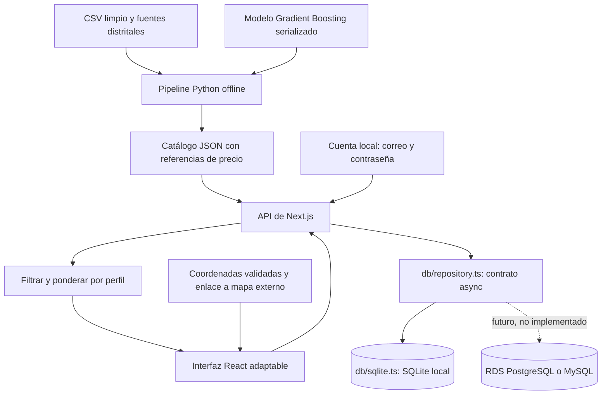

# InmoScore — Week 10: prototipo funcional

**DS3022 · Desarrollo de Producto de Datos · UTEC · 2026-2**  
**Hito:** prototipo funcional, 14 de octubre de 2026  
**Corte de implementación y verificación:** 24 de octubre de 2026  
**Piloto:** vivienda propia en Lima Metropolitana.

## 1. Propósito y alcance

InmoScore ayuda a comparar viviendas según la situación financiera y las prioridades del comprador. Integra una referencia de precio estimada por un modelo, atributos del inmueble e indicadores distritales de seguridad y conveniencia. El usuario puede entender la recomendación, modificar sus prioridades y conservar opciones para compararlas.

Esta entrega transforma el prototipo HTML de Week 7 en una aplicación Next.js con interfaz adaptable, API y persistencia por cuenta. El recorrido principal es **landing → registro e inicio de sesión → perfil → recomendaciones → detalle → guardados y comparación**. Cada comprador crea una cuenta con correo y contraseña.

El catálogo conserva **3 896 avisos históricos**, provenientes del dataset público de Urbania usado en el proyecto. No se presenta como inventario actualmente disponible. Esta versión usa una ilustración genérica cuando faltan fotografías; no representa la vivienda anunciada. No se realizan contactos, reservas ni aprobaciones hipotecarias.

## 2. Funcionalidades implementadas

| Funcionalidad | Comportamiento implementado | Evidencia |
|---|---|---|
| Landing | Propuesta del producto, proceso en tres pasos y búsqueda inicial por distrito, dormitorios y presupuesto | `app/page.tsx`, `screenshots/01-landing.jpg` |
| Inicio de sesión | Cuenta propia con correo y contraseña | `screenshots/02-login.jpg` |
| Registro de InmoScore | Alta del perfil asociado a la identidad, nombre, ingreso, ahorro, presupuesto y preferencias; consentimiento de guardado | `/registro`, `/api/profile` |
| Perfil y cuenta | Editar perfil, consultar identidad, cerrar sesión y eliminar los datos propios de InmoScore | `/perfil`, `/cuenta`, `/api/account` |
| Ranking personalizado | Filtros obligatorios y puntuación según precio, seguridad y conveniencia; orden por afinidad o precio; paginación | `lib/recommendation.ts`, `/api/ranking` |
| Capacidad de compra | Tope por ingreso, ahorro y presupuesto bajo supuestos hipotecarios explícitos | `affordableCap()` |
| Detalle | Precio publicado frente a referencia, atributos, indicadores, precisión geográfica y datos faltantes | `/inmueble/{id}`, `screenshots/05-detail.jpg` |
| Guardados | Favoritos persistidos en SQLite por cuenta y recuperados después de recargar | `/guardados`, `/api/favorites` |
| Comparación | Tabla de hasta tres viviendas con precios, atributos, mantenimiento e indicadores | Función de comparación en la aplicación |
| Ubicación | Punto aproximado y enlace a OpenStreetMap cuando un aviso tiene coordenadas; sin mapa distrital local en esta versión | Función de ubicación en la aplicación |
| Vista móvil | Navegación compacta, filtros desplegables y tarjetas en una columna | `screenshots/07-mobile.jpg` |
| Estados de interfaz | Carga, errores de validación, búsqueda sin coincidencias, ausencia de coordenadas y cuenta anónima | UI, pruebas unitarias y de API |

InmoScore administra sus propias cuentas con correo y contraseña. El registro crea una cuenta y su perfil de comprador. No se crean usuarios automáticos ni se simula una sesión: las pruebas usan cuentas sintéticas registradas por el mismo flujo local. Las contraseñas se almacenan con scrypt, salt aleatorio y parámetros N=32768, r=8, p=3. Cada sesión usa un token aleatorio en una cookie HttpOnly y SameSite=Lax; SQLite almacena el hash del token. El cierre de sesión revoca la sesión. La eliminación de cuenta borra el perfil, los favoritos y las sesiones de esa cuenta.

## 3. Datos y procesamiento

### 3.1 Insumos contenidos en Week 10

| Insumo | Contenido y uso |
|---|---|
| `data/listings_clean.csv` | 3 896 avisos, 20 distritos, atributos, contexto, valores originales y marcas de calidad |
| `data/sources/zone_index_distrito.csv` | Índices distritales para seguridad y conveniencia |
| `data/sources/listings_geocoded.csv` | 200 consultas de geocodificación; se muestran 133 coordenadas con precisión de calle o edificio y validación registrada |
| `data/sources/duplicate_links_lookup.json` | Enlaces recuperados y retiros conocidos en una revisión anterior; no es un monitoreo en tiempo real |
| `models/source_model.joblib` | Artefacto confiable de la evaluación previa, incluido para reproducir la exportación |
| `models/valuation_model.joblib` | Pipeline de scikit-learn portable, columnas de entrada y transformación del objetivo |
| `models/evaluation/` | Métricas, protocolo, particiones y evidencia de evaluación |

`analytics/prepare_data.py` lee únicamente los insumos contenidos en esta entrega, ejecuta el modelo sobre los avisos y escribe `data/catalog.json`, perfiles de ejemplo y manifiesto SHA-256. No accede al portal ni actualiza disponibilidad. La web no necesita Python para cada búsqueda: consume el catálogo generado por lotes.

### 3.2 Calidad y procedencia

Los 2 006 mantenimientos originalmente codificados como cero conservan su valor original y se representan como ambiguos. Otros tres importes sospechosos quedan ausentes para modelado. Por tanto, **2 009 avisos tienen mantenimiento no confirmado** en el catálogo. No se inventaron cuotas ni tipos de cambio.

Los 24 avisos de 12 grupos de posibles duplicados se conservaron con un identificador de grupo. No se asume que coincidencia de dirección, precio y área pruebe identidad de la vivienda. En esta iteración, los anuncios que constaban como retirados en la revisión de enlaces se excluyen del ranking; todos los demás mantienen disponibilidad no verificada.

El catálogo histórico original tenía 3 987 avisos. El procesamiento previo descartó 91 por IQR distrital de precio por m². No se recuperaron esas filas en Week 10. La fecha de modificación del archivo fuente no demuestra la fecha de publicación de cada anuncio.

## 4. Arquitectura y decisiones técnicas

**Interfaz.** Next.js estándar con React, CSS propio y Lucide, ejecutado sobre Node.js. Se conserva el nombre InmoScore y se incorpora una dirección visual de tonos claros, verde oscuro y acentos naturales. La tipografía usa `rem`, con base entre 18 y 22 px y mínimo de 14,6 px. La navegación distingue explorar, perfil, guardados y cuenta. Los requisitos mínimos se separan de las prioridades relativas. Se usan controles nativos, foco visible, diálogo de comparación con manejo de foco y Escape, y soporte para movimiento reducido.

**Servicio.** La API recibe un perfil validado y calcula el ranking sobre datos precalculados. Se limita el tamaño de página y se rechazan números no finitos, rangos inválidos, identificadores desconocidos y pesos todos cero. No se registran perfiles financieros de visitantes al solicitar recomendaciones; se persisten cuando el usuario guarda su perfil.

**Persistencia y cuentas.** `db/repository.ts` define un contrato asíncrono y `db/sqlite.ts` lo implementa con SQLite. Al iniciar, la aplicación crea `storage/inmoscore.sqlite`; cada copia tiene su propia base, ignorada por Git, sin migración manual ni base compartida. El registro valida correo y contraseña, guarda el hash scrypt con salt aleatorio y crea un perfil propio. El servidor genera tokens aleatorios de sesión, los entrega en cookies HttpOnly y SameSite=Lax, y conserva en SQLite solo sus hashes. La API aplica el identificador de cuenta derivado de la sesión a cada consulta. El cierre de sesión revoca el token. La eliminación de cuenta borra los datos y sesiones asociados. Una implementación futura para RDS requeriría otro adaptador y migraciones propias; no está implementada.

**Modelo por lotes.** El servidor Next.js recibe precios de referencia ya calculados. Esto permite conservar la integración analítica con scikit-learn y ejecutar una aplicación local ligera. La aplicación no reentrena ni vuelve a seleccionar el modelo con solicitudes de compradores.

**Ubicación.** Se usan únicamente las coordenadas disponibles; no se colocan avisos en el centro del distrito por defecto. Cuando hay coordenadas, la ficha ofrece un enlace a OpenStreetMap y advierte que el punto es aproximado. Esta versión no contiene el GeoJSON necesario para un mapa distrital local.

## 5. Componente analítico y personalización

### 5.1 Valoración

Se integra el Gradient Boosting seleccionado en la evaluación por grupos. Usa área, dormitorios, baños, cocheras, mantenimiento, distrito y contexto distrital para predecir el logaritmo del precio de oferta. La salida en soles se obtiene con `exp()`. El pipeline exportado no contiene variables derivadas del precio como entradas.

| Evaluación | Avisos | MAE línea base | MAE Gradient Boosting | Reducción de MAE |
|---|---:|---:|---:|---:|
| Desarrollo, predicciones fuera de cinco pliegues | 3 117 | S/ 154 449 | S/ 135 553 | 12,2 % |
| Prueba final reservada para esa selección | 779 | S/ 153 665 | S/ 119 801 | 22,0 % |

MdAPE final: **12,2 %**. Son métricas de la evaluación previa, copiadas como evidencia, no recalculadas utilizando los perfiles de la aplicación. El modelo integrado fue entrenado solo con desarrollo, tras el IQR correspondiente; no se incorporó la prueba final al ajuste.

La nueva partición agrupa posibles duplicados e IQR se aprende con entrenamiento, pero parte de un snapshot ya filtrado históricamente. Además, sus filas ya participaron en el trabajo de Week 7. No constituye validación temporal ni externa. En los 36 inmuebles de S/ 2 millones o más, el MAE del modelo empeora aproximadamente 2,6 % frente a la línea base. La mejora agregada no es uniforme.

No se muestran intervalos del 80 % del modelo antiguo porque no fueron recalibrados para el modelo actual. El error mediano agregado tampoco se presenta como intervalo o garantía por inmueble.

### 5.2 Ranking

Primero se filtra por el menor de presupuesto declarado y precio alcanzable; luego por dormitorios, área, distritos y, opcionalmente, presencia de coordenadas. La simulación financiera usa TEA 9 %, plazo de 20 años, cuota máxima del 30 % del ingreso e inicial mínima del 10 %. La tasa mensual se deriva de la TEA y el ahorro se suma a la capacidad de crédito. No se incluyen seguros, deudas existentes ni costos de cierre.

La puntuación es una media ponderada de tres componentes normalizados: oportunidad de precio, percentil distrital de seguridad y percentil distrital de conveniencia. Los pesos son preferencias explícitas del comprador. El indicador de precio usa `(referencia − precio pedido) / referencia`. Para evitar mezclar escalas de cobertura desigual, la conveniencia del ranking es distrital para todos los avisos; el mapa conserva las coordenadas individuales sin convertirlas automáticamente en una nueva escala de conveniencia.

El orden por afinidad admite hasta tres avisos por distrito para diversificar la selección. El orden por precio conserva todas las coincidencias con los filtros. La afinidad no expresa probabilidad de satisfacción. Las diferencias de precio, los indicadores de denuncias y los datos faltantes se explican con sus límites.

## 6. Verificación del prototipo

| Verificación | Resultado |
|---|---|
| Modelos y ranking | 9 pruebas unitarias existentes: filtros, paginación, diversidad, pesos inválidos, coordenadas, TEA y retiros conocidos |
| Datos y modelo | Catálogo con 3 896 avisos y 20 distritos; 133 ubicaciones válidas. Las 100 referencias comprobadas del JSON coinciden con el pipeline serializado |
| Compilación y tipos | Build de Next.js y TypeScript sin errores |
| Contraseñas y tokens | 4 pruebas: salt único, verificación correcta, Unicode, formato y límites |
| SQLite y aislamiento | 5 pruebas: creación automática, reapertura, cuentas aisladas, caducidad/revocación, borrado en cascada y límites de intentos |
| API local | 33 comprobaciones con cuentas sintéticas: registro, sesiones, origen, persistencia, ranking y eliminación aislada |
| Navegador | Registro, perfil, guardados, cierre y nuevo inicio de sesión comprobados |
| Tipografía adaptable | Ranking sin desbordamiento horizontal en 320, 390, 768, 1440, 2560 y 3840 px; base tipográfica de 18 a 22 px |

Las 18 pruebas unitarias y las 33 comprobaciones de API pasan. Las comprobaciones de API también se ejecutaron sobre el build de producción local. Las pruebas crean sus propias cuentas y bases temporales y las eliminan al terminar; no borran datos de otras cuentas locales. Los resultados de API y de tamaños de pantalla están en `tests/results/`. Las capturas usan una cuenta registrada con datos sintéticos y no incorporan la base SQLite a la entrega.

La verificación del ranking no reemplaza una evaluación de usabilidad con compradores, una auditoría completa de accesibilidad ni pruebas de carga o seguridad de producción.

## 7. Capturas y demostración

| Archivo | Pantalla |
|---|---|
| `screenshots/01-landing.jpg` | Propuesta del producto y búsqueda inicial |
| `screenshots/02-login.jpg` | Inicio de sesión con correo y contraseña |
| `screenshots/03-profile.jpg` | Perfil financiero y requisitos |
| `screenshots/04-ranking.jpg` | Ranking y filtros de escritorio |
| `screenshots/05-detail.jpg` | Detalle de vivienda y referencia |
| `screenshots/06-saved.jpg` | Favoritos persistidos |
| `screenshots/07-mobile.jpg` | Ranking móvil |
| `screenshots/08-compare.jpg` | Comparación de dos viviendas |
| `screenshots/09-map.jpg` | Vista de ubicaciones disponibles |
| `screenshots/10-register.jpg` | Registro propio con confirmación de contraseña |
| `screenshots/11-account.jpg` | Cuenta y cierre de sesión propios |

El guion reproducible está en `DEMO.md`; no se requiere un video para reproducir el recorrido.

## 8. Desafíos técnicos y decisiones

1. **Datos disponibles frente a inventario vigente.** Se mantuvo el dataset académico y se declaró su condición histórica. No se ejecutó un scraper nuevo ni se asumió disponibilidad por obtener una ficha indexada.
2. **Portabilidad del modelo.** El artefacto evaluado contenía wrappers de código del proyecto. Se incluyeron sus fuentes para abrirlo y se exportó un pipeline de scikit-learn sin dependencia de módulos privados de otras entregas.
3. **Costo de inferencia en el runtime web.** Se calculan referencias offline y se sirve un catálogo JSON. La API online ejecuta filtros y ponderaciones; se puede regenerar el catálogo sin reescribir la UI.
4. **Coordenadas incompletas.** Se recuperaron correctamente 133 puntos con precisión de calle/edificio. Los demás avisos conservan contexto distrital sin puntos ficticios.
5. **Consistencia financiera.** Se corrigió el cálculo de tasa efectiva mensual y la combinación de crédito con ahorro. Los supuestos están visibles y no se confunden con una oferta bancaria.
6. **Cuentas y persistencia.** La aplicación administra cuentas propias y guarda perfiles/favoritos en SQLite local. El contrato asíncrono del repositorio separa la interfaz de persistencia; un adaptador para RDS y sus migraciones quedan como trabajo futuro.
7. **Alcance de archivos.** La implementación nueva, los entornos de trabajo y los artefactos de entrega se concentran en `deliveries/week10/`. El generador entregado utiliza copias locales de los insumos y no requiere modificar las semanas previas.

## 9. Publicación y trabajo restante

La entrega se ejecuta localmente sobre Node.js. No se incluye una URL publicada. El arranque crea la base vacía de cada instalación y los reinicios conservan su contenido. El README documenta instalación, creación automática de SQLite y comandos de desarrollo y producción. El diseño de persistencia permite implementar en el futuro otro adaptador para RDS, junto con migraciones propias; ese adaptador no está incluido. También quedan para esa etapa el correo de verificación/recuperación, conexiones TLS y controles de autenticación para múltiples instancias.

| Prioridad | Trabajo restante |
|---|---|
| Must | Obtener una fuente autorizada de inventario vigente y registrar URL, estado y fecha de verificación |
| Must | Recuperar o sustituir los 91 avisos históricamente excluidos y realizar una evaluación con datos nuevos |
| Must | Ampliar geocodificación y validar precisión antes de usar distancias por inmueble |
| Should | Pruebas con compradores piloto, auditoría WCAG y revisión de seguridad antes de acceso en red |
| Should | Refresco programado, monitoreo de calidad, trazabilidad de snapshots y ciclo de promoción de modelos |
| Should | Añadir atributos físicos: antigüedad, piso, ascensor, estado, área techada y áreas comunes verificadas |
| Could | Intervalos recalibrados y explicaciones por contribución de variables |
| Could | Constructoras y sanciones solo cuando exista enlace confiable con cada aviso |

El prototipo satisface el recorrido funcional con datos representativos del proyecto. El paso a un servicio de recomendaciones sobre inmuebles disponibles depende primero de actualizar y verificar el inventario.
